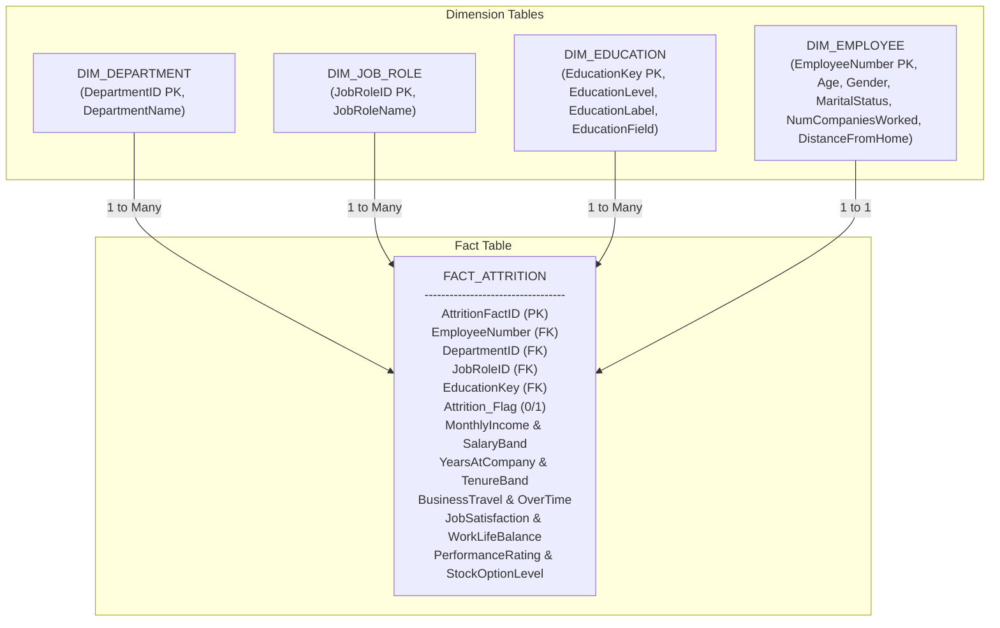

# Project 10: Employee Attrition Analysis
## Document 02: Entity-Relationship & Star Schema Architectural Blueprint
**Candidate Name:** Ranjan Maiti  
**Candidate Roll No:** 2500321540146  
**Institution / Program:** HCLTech Career Shaper  

---

### 1. Conceptual vs Logical Architecture
The project transitions from a flat, operational transaction layout (35 denormalized columns in the raw IBM HR dataset) to an enterprise-grade **Star Schema** data warehouse architecture. This reduces data redundancy, enforces foreign key constraints, and maximizes analytical query performance in Oracle SQL and Power BI VertiPaq.

---

### 2. Comprehensive Data Dictionaries

#### Table 1: `DIM_DEPARTMENT`
- **Grain:** One record per organizational business unit.
- **Primary Key:** `DepartmentID` (INTEGER)
- **Rows:** 3
- **Attributes:**
  - `DepartmentID`: Unique numerical identifier (1 = Human Resources, 2 = Research & Development, 3 = Sales).
  - `DepartmentName`: Full official business unit title.

#### Table 2: `DIM_JOB_ROLE`
- **Grain:** One record per job title / designation.
- **Primary Key:** `JobRoleID` (INTEGER)
- **Rows:** 9
- **Attributes:**
  - `JobRoleID`: Unique identifier (1 to 9).
  - `JobRoleName`: Healthcare Representative, Human Resources, Laboratory Technician, Manager, Manufacturing Director, Research Director, Research Scientist, Sales Executive, Sales Representative.

#### Table 3: `DIM_EDUCATION`
- **Grain:** One record per combination of Education Level and Academic Major.
- **Primary Key:** `EducationKey` (INTEGER)
- **Rows:** 30
- **Attributes:**
  - `EducationKey`: Unique integer surrogate key.
  - `EducationLevel`: 1 (Below College), 2 (College), 3 (Bachelor), 4 (Master), 5 (Doctor).
  - `EducationLabel`: Descriptive qualification tier.
  - `EducationField`: Life Sciences, Medical, Marketing, Technical Degree, Human Resources, Other.

#### Table 4: `DIM_EMPLOYEE`
- **Grain:** One record per unique employee (SCD Type 1).
- **Primary Key:** `EmployeeNumber` (INTEGER)
- **Rows:** 1,470
- **Attributes:**
  - `EmployeeNumber`: Unique employee identifier.
  - `Age` & `AgeGroup`: Exact age and demographic bucket (18-29, 30-39, 40-49, 50+).
  - `Gender`: Male / Female.
  - `MaritalStatus`: Single, Married, Divorced.
  - `NumCompaniesWorked`: Career mobility history.
  - `TotalWorkingYears`: Cumulative career experience.
  - `DistanceFromHome`: Commute distance in miles.

#### Table 5: `FACT_ATTRITION`
- **Grain:** One record per employment lifecycle observation.
- **Primary Key:** `AttritionFactID` (INTEGER)
- **Foreign Keys:** `EmployeeNumber`, `DepartmentID`, `JobRoleID`, `EducationKey`.
- **Rows:** 1,470
- **Key Measures & Dimensions:**
  - `Attrition_Flag`: 1 if separated, 0 if active.
  - `MonthlyIncome`: Base salary in USD.
  - `SalaryBand`: Discretized compensation band.
  - `Is_Salary_Outlier`: 1 if above 1.5x IQR threshold ($16,581), 0 otherwise.
  - `YearsAtCompany`: Current tenure duration in years.
  - `TenureBand`: 0-2 Years, 3-5 Years, 6-10 Years, 10+ Years.
  - `OverTime`: Boolean flag indicating regular overtime obligations (Yes/No).
  - `JobSatisfaction`: 1 (Low) to 4 (Very High).
  - `WorkLifeBalance`: 1 (Bad) to 4 (Best).
