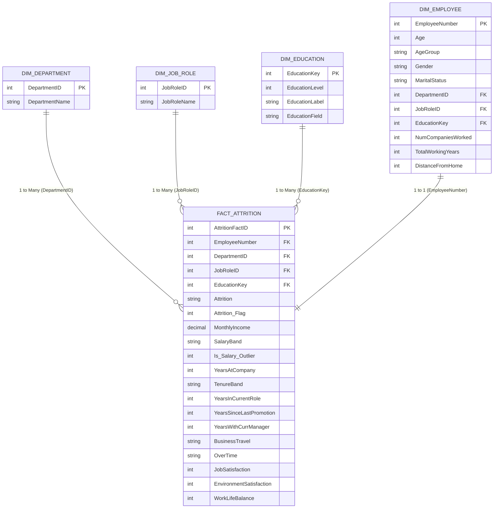

# Power BI Data Modeling & Relationship Specification
## Project 10: Employee Attrition Analysis
**Author:** Ranjan Maiti | **Roll No:** 2500321540146

---

### 1. Conceptual Architecture: Star Schema Design
In enterprise BI architectures, flat denormalized tables introduce redundancy, slow down DAX filter propagation, and increase `.pbix` memory footprint. To adhere to industry best practices, the dataset is modeled as a formal **Star Schema**:

---

### 2. Relationship Cardinality Matrix

| Primary Key Table (Dimension) | Join Key Column | Foreign Key Table (Fact) | Join Key Column | Cardinality | Cross Filter Direction | Security Filter |
| :--- | :--- | :--- | :--- | :--- | :--- | :--- |
| `Dim_Department` | `DepartmentID` | `Fact_Attrition` | `DepartmentID` | One to Many (`1:*`) | Single | Both = False |
| `Dim_JobRole` | `JobRoleID` | `Fact_Attrition` | `JobRoleID` | One to Many (`1:*`) | Single | Both = False |
| `Dim_Education` | `EducationKey` | `Fact_Attrition` | `EducationKey` | One to Many (`1:*`) | Single | Both = False |
| `Dim_Employee` | `EmployeeNumber` | `Fact_Attrition` | `EmployeeNumber` | One to One (`1:1`) | Both / Single | Both = False |

---

### 3. Filter Propagation & Performance Rules
1. **Single Direction Filtering:** Filters always propagate outward from dimension tables down to `Fact_Attrition`. Bi-directional filtering is avoided to eliminate ambiguous relationship loops and performance bottlenecks.
2. **Surrogate Keys:** Integer surrogate keys (`DepartmentID`, `JobRoleID`, `EducationKey`) are used instead of strings for query execution speed in the VertiPaq engine.
3. **Sort By Column:**
   - In `Fact_Attrition`, sort `TenureBand` by a custom numerical index (1 for `0-2 Years`, 2 for `3-5 Years`, etc.) so charts display chronological order rather than alphabetical order.
   - Sort `SalaryBand` by a numerical index (1 for `Low (<3.5k)`, 2 for `Mid`, 3 for `High`, 4 for `Executive`).
